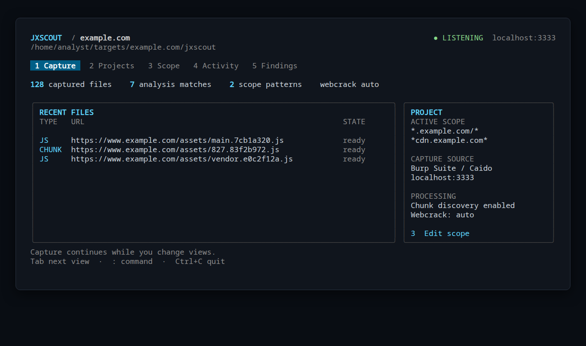

# JXScout

Capture JavaScript through Burp Suite or Caido, discover hidden chunks, and inspect
static analysis results. Initialize a project in your target directory, run
`jxscout serve`, and browse the target through your proxy.



*Dashboard preview rendered by the application with example data.*

## Features

- **Automatic chunk discovery:** find imports, precache manifest URLs, Webpack runtime builders, and hidden ID/hash tables. Discovered scripts enter the same recursive pipeline.
- **Validated downloads:** candidate responses must succeed and pass a JavaScript parser before they are saved. HTML fallbacks, JSON, CSS, and malformed scripts are rejected.
- **Discovery on capture and restart:** process scripts without waiting for formatting, resume from saved project files, and restore missing discovered files.
- **Named local projects:** remember each project's output folder and scope; switch projects without changing the Burp listener's host or port.
- **In-place formatting:** use Webcrack or Prettier on the same `.js` file, without raw snapshots, `.webcrack` folders, or bundle extraction.
- **Analysis you can inspect:** view matches and source locations in the dashboard, or query assets, discovery outcomes, and findings as JSON/JSONL.

## Install

Build dependencies: Go 1.23.2 or newer and Bun. Bun is required at runtime;
Prettier provides formatting, and optional Webcrack requires a supported Node.js
version.

```sh
git clone https://github.com/r1pu5u/jxscout.git
cd jxscout
bun install --frozen-lockfile
bun run scripts/build-agent-cli.ts
go install ./cmd/jxscout

bun install -g prettier
npm install -g webcrack
jxscout doctor --format json
```

The executable is installed in `GOBIN`, or `$(go env GOPATH)/bin` when `GOBIN` is
unset. Add that directory to your PATH. Use `make build` to rebuild all embedded
JavaScript processors after changing their sources.

## Initialize a project

Run `init` in the directory where you want the project's output:

```sh
mkdir -p ~/target/example.com
cd ~/target/example.com
jxscout init --project example.com \
  --scope '*.example.com/*' \
  --scope 'https://example.com/*'
jxscout serve
```

This registers `example.com` with output at `~/target/example.com/jxscout`.
`init` creates the configuration; downloads begin when `serve` receives traffic
or resumes discovery from saved scripts.

You can select the initialized project from any directory:

```sh
jxscout serve --project example.com
```

`-p` and `--project-name` are aliases for `--project`. Repeat `--scope` to add
patterns. Use `init --force` with the complete scope list to update an existing
workspace; explicit `serve --scope` flags override scope for that invocation.
Project records are stored in `~/.config/jxscout/projects.json`.

Scope patterns match **full URLs**, including paths and queries. They are not
domain-only filters. For example, `*.example.com/*` covers subdomains but excludes
the bare `example.com` host, so the example above includes a second pattern.
Quote patterns to prevent shell expansion.

## Connect Burp or Caido

Install the [Burp extension](https://github.com/francisconeves97/jxscout-burp) or
[Caido plugin](https://github.com/francisconeves97/jxscout-caido).

For Burp, set **Server Host** to `localhost` and **Server Port** to `3333` in the
JXScout extension, then click **Save**. Configure Burp's Target scope separately
when using the extension's **Filter In-Scope** option. JXScout's scope patterns
do not change Burp's settings.

Browse your target through the proxy. Disable browser caching so scripts pass
through the proxy. JXScout saves scripts, discovers candidate chunks, validates
responses, and downloads valid JavaScript automatically within its scope.
It skips known Cloudflare challenge paths and icons, and parses HTML in memory
to find scripts rather than saving page copies.

## Dashboard

`jxscout serve` opens the terminal dashboard. Use number keys or Tab to navigate:

| View | What it shows |
| --- | --- |
| **1 Capture** | Recent scripts, discovered chunks, saved-file counts, and analysis-match counts |
| **2 Projects** | Initialized projects, output folders, and scope; Enter switches project |
| **3 Scope** | URL patterns; **a** adds, **Enter** saves, **Delete** removes the selected pattern |
| **4 Activity** | Processing logs; **s** toggles following, **c** clears the log buffer |
| **5 Findings** | Static analysis matches, analyzer categories, code snippets, and file locations |

F2–F5 also open the corresponding views. Press **:** for commands and **Esc** to
cancel an edit or return to capture. Command output scrolls with the arrow keys.
Ctrl+C stops the listener. Existing commands such as `config`, `logs`, and Caido
overrides remain available. Analysis matches are review leads, not confirmed
vulnerabilities.

Switching projects restores the selected project's scope and output folder while
keeping the listener host and port. Interactive scope changes are saved.

```text
project example.com
scope add *.cdn.example.com/*
scope remove *.cdn.example.com/*
```

For agents and scripts, run the same listener without the dashboard:

```sh
jxscout serve --project example.com --headless
jxscout assets --project example.com --format json
jxscout chunks --project example.com --format json
jxscout findings --project example.com --search fetch --format json
```

Chunk queries include recorded outcomes such as `fetching`, `downloaded`,
`not_found`, `invalid_js`, and `error`. Duplicate candidate URLs are suppressed
across scripts.

## Output and formatting

```text
~/target/example.com/jxscout/
├── config.json
├── original/
│   └── www.example.com/
│       └── assets/
│           ├── app.7cb1a320.js
│           └── 827.83f2b972.js
└── .state/
    └── example.com/             # Databases, settings, and logs
```

Webcrack formats JavaScript **in place**, with module extraction disabled. It does
not create `raw/` or `.webcrack` folders. Extensionless script URLs are saved with
a `.js` extension. Source-map recovery remains available separately, alongside
the [VSCode integration](https://github.com/francisconeves97/jxscout-vscode).

| Mode | Behavior |
| --- | --- |
| `--webcrack auto` | Use Webcrack when available; fall back to Prettier if needed |
| `--webcrack off` | Use Prettier only |
| `--webcrack required` | Require Webcrack and report formatting failures |

Chunk discovery runs independently of formatting, and saved scripts are revisited
when `serve` starts. Supplied credentials are not forwarded to other origins;
scope is also checked on redirect targets.

## Optional local analysis

Process files already on disk without proxy capture:

```sh
jxscout analyze ./downloaded-js --webcrack auto --format json
jxscout runs --format json
```

Local analysis follows local dependencies. Remote requests require `--fetch` and
still obey scope. Explicit source-map comments and inline maps containing
`sourcesContent` are supported. Query results support `--search`, `--page`, and
`--page-size`; local runs can be filtered with `--run`.

Text is the default output format. JSON emits a versioned result; JSONL emits
progress records followed by a summary. Diagnostics go to stderr. Exit codes are
`0` for completion, `1` for invalid input or fatal errors, `2` for partial results,
and `130` for interruption.

See [the CLI guide](docs/agent-cli.md) for more options and
[the analysis tree reference](docs/tree.md) for the VSCode hierarchy.

## Discovery resource usage

Discovery shares one parser/validator slot by default, independently of HTTP
fetch concurrency. Source files stream into the parser instead of being held in
Go memory while downloads run. A single AST serves the discovery strategies;
in-memory deduplication caches are bounded. Candidate results are cached in the
project's SQLite state and reused when the script, seed URLs, parser version,
and brute-force limit match; restarting still checks for missing chunk files.

Use `--chunk-parser-concurrency 1` for the lowest parallel parser memory usage,
or increase it to trade more memory for parallel analysis. Formatting and AST
findings have separate concurrency controls. For lower overall memory use:

```sh
jxscout serve --chunk-parser-concurrency 1 \
  --beautifier-concurrency 1 --ast-analyzer-concurrency 1
```

HTTP gzip bodies are streamed into the final response text instead of retaining
full compressed and decompressed copies. Webcrack streams its output to a
short-lived file and atomically replaces the same `.js` on success; partial or
empty formatter output never replaces the script. Formatter and discovery
stderr buffers retain at most 8 KiB each.

A local 6 MB gzip-response benchmark reduced Go allocations from about 39.4 MB
to 16.5 MB per response, with identical decoded content. Reproduce the allocation
comparison on your machine with:

```sh
go test ./internal/core/asset-fetcher -run '^$' \
  -bench BenchmarkGzipResponseMemory -benchmem
```

## Development

```sh
bun install --frozen-lockfile
make build
go build -o jxscout ./cmd/jxscout
go test ./...
JXSCOUT_TEST_BINARY="$PWD/jxscout" bun run vitest run
```

## Upstream and license

Based on [francisconeves97/jxscout](https://github.com/francisconeves97/jxscout).
The JS Deep-style filename-template approach informed this fork's additional
hidden chunk discovery. See [COPYING](COPYING) for the license.
